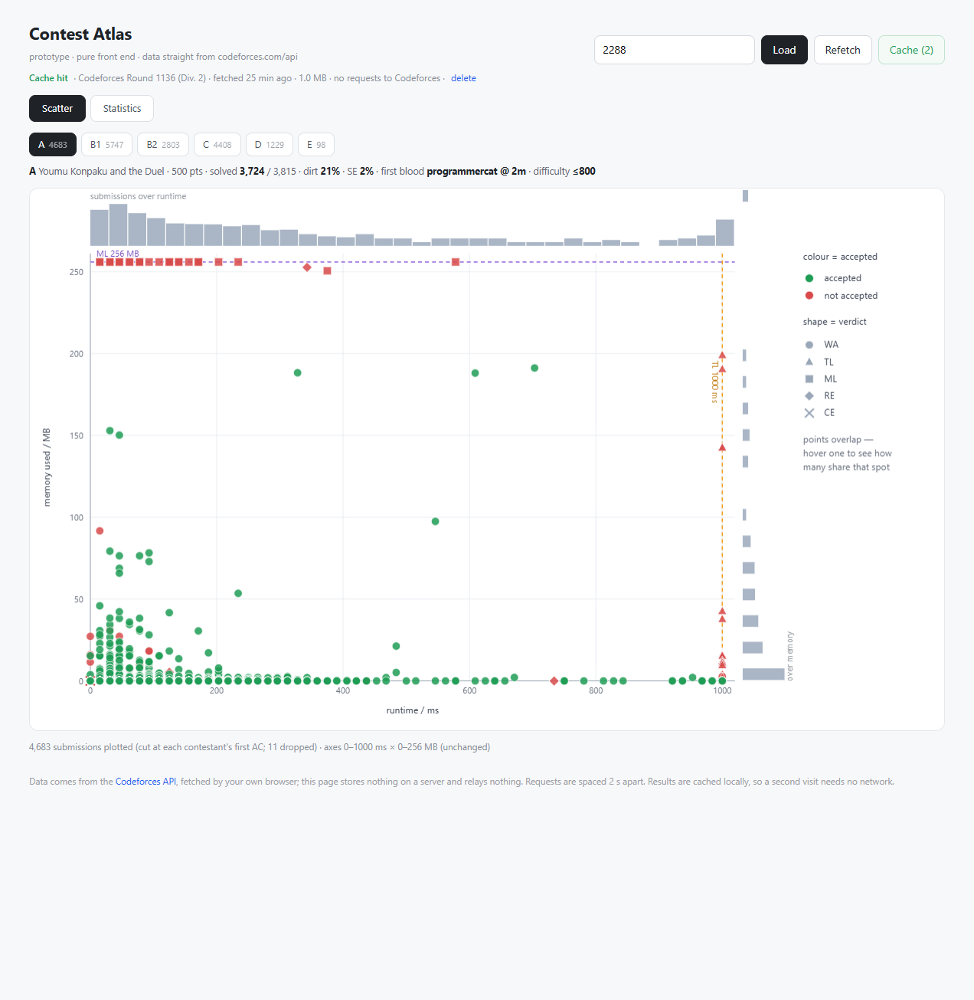
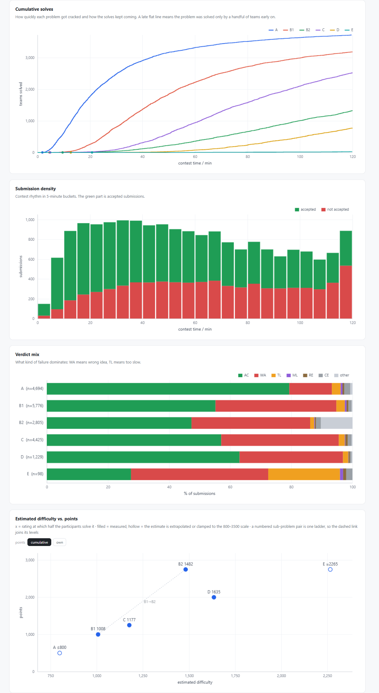

# Contest Atlas

**English** · [简体中文](README.zh-CN.md)

**The judge-side view of a Codeforces contest — drawn in your browser, from the official API, with no backend and no build step.**

Codeforces shows a contest as a ranking. This shows the same contest as *distributions*: every submission placed
in the (runtime, memory) plane, every problem's solve curve, the verdict mix, the first blood and an estimated
difficulty — for any contest id you type in, from the archive to the round that finished an hour ago.

Everything runs on the visitor's machine. There is no server, no proxy, no account and no tracking; the page talks
to `codeforces.com/api` directly and keeps the result in IndexedDB, so a second visit needs no network at all.

Live: <https://lnight121.github.io/codeforces-contest-atlas/>



## Use it

Open `index.html` in a browser — `file://` works, CORS is allowed by the API. Or serve the folder:

```bash
python -m http.server 8000     # then open http://localhost:8000/#2289
```

Type a contest id, or deep-link with the hash: `#2289`. Picking another problem is a tab; `Statistics` switches to
the eight aggregate charts.

## What you get

**Scatter** — the same drawing as the reference matplotlib pipeline: one marker per submission, radius 5.2,
green = accepted, red = not accepted, shape = verdict (WA / TL / ML / RE / CE). Each contestant's submissions are
cut at their first AC, so the plot answers "what did it cost these people to get there". Marginal histograms on
both axes, the TL/ML walls drawn where they are, and a tooltip that reports how many submissions share the exact
same point — Codeforces quantises runtime to 1 ms and memory to 100 KB, so piles are the normal case.

**Statistics** — the eight charts of the analysis pipeline, recomputed in the browser:

| chart | what it shows |
|---|---|
| Cumulative solves | solve curve per problem, dot = first accepted submission |
| Cumulative unsolves | the same contest seen through failed submissions |
| Submission density | submissions per 5-minute bucket, accepted stacked on top |
| First blood | when each problem was first cracked, with the handle |
| Solves vs. attempts | difficulty plane: solved count against mean submissions per solver |
| Submissions needed | how many tries the solving teams needed |
| Verdict mix | 100 % stacked AC / WA / TL / ML / RE / CE / other |
| Difficulty vs. points | estimated difficulty against the points the setters assigned; sub-problems (A1, A2, …) are one ladder — the dashed link joins the levels and a toggle switches between the running point total and each problem's own points |



## Where the data comes from

| call | why |
|---|---|
| `contest.standings?contestId=` | the official roster — participants Codeforces removed from the standings are excluded here, without extra work |
| `contest.status?contestId=&from=&count=` | the submissions of the contest itself |
| `contest.ratingChanges?contestId=` | `oldRating` for the whole contest in **one** request — the pre-contest ratings the difficulty estimate needs |

`contest.status` returns newest first, and after the round the head of that list fills up with practice and virtual
traffic that grows to many times the size of the contest itself. Fetching it page by page would be wasteful, so the
client finds the boundary instead: one-row probes at 10 k, 20 k, 40 k … until it lands on an in-contest row, a
binary search to within 10 k, then **one** bulk request for everything from there to the end. That is a handful of
tiny requests plus one big one, and it only over-fetches at most one stride of practice rows. If the tail ever
exceeds the request cap the page says so instead of pretending the data is complete.

Two things the API does not expose, so they are derived:

- **Time and memory limits.** No method returns them, so they are read off the verdicts: the largest reported
  runtime among `TIME_LIMIT_EXCEEDED`, the largest memory among `MEMORY_LIMIT_EXCEEDED`. When nobody hit a wall,
  the bound is a rounded-up maximum of observed values and the axis label says `(inferred)`.
- **Difficulty.** A port of the reference estimator: a binned 50 % crossing, plus a logistic
  `P(solve | rating)` whose slope is pooled over the problems where the crossing is identifiable. Saturated
  problems use the extrapolation, clamped to the 800–3500 scale and printed as `≈1934`, `≤800`, `≥3500`.

## Cost, measured on contest 2288

| | |
|---|---|
| first visit | a few probes + 1 bulk request · 21.9 MB · ~14 s (the 2 s pacing is the API's, not ours) |
| second visit | 0 requests · 0 bytes · instant, restored from IndexedDB |
| cache footprint | 1.03 MB for 3,933 teams and 19 k submissions (strings factored into dictionaries) |

The cache stores only raw-ish rows plus the official roster and its ratings; every derived number — difficulty,
dirt, SE, the histograms — is recomputed on load. That way changing an estimator can never hide behind a stale
entry. Entries are version-stamped: an entry written by another build is ignored, not silently rendered.

The `Cache` button opens the local store: every cached contest with its team count, packed size, age and a
`open` / `delete` link, plus the browser's own storage estimate. Eviction keeps at most 20 contests or 64 MB,
least-recently-used first, so the list cannot grow without bound in the origin's quota.

## Deliberate choices

- **The axes are never rescaled.** `0 … TL×1.02` and `0 … ML×1.02`, exactly as the reference plots. Fitting the
  data instead would make the walls land in meaningless places and would make two problems incomparable.
- **No fill or smoothing of the submission cloud.** Overlap is real information; the tooltip quantifies it.
- **Numbered sub-problems are read as a ladder, not as a containment claim.** A1 and A2 are scored separately, so
  anyone who can solve A2 is better off solving A1 first — the standings pay for the prefix, and that is what the
  chart plots by default. Whether A2's statement really contains A1 is something only the setter knows: the
  submission data cannot tell the two apart, because the scoring rule pushes almost every A2-solver through A1
  anyway. So the chart states the convention
  instead of guessing — a dashed link joins the levels, and the toggle offers the marginal reading.
- **No cookie, no analytics, no localStorage.** Results live in IndexedDB, one entry per contest, and the cache
  panel can delete them one by one or all at once.

## Known limitations

- One contest per load. A round with separate Div. 1 / Div. 2 contests needs two loads (the reference site shows
  them side by side).
- The pooled logistic slope is a constant (`POOLED_SLOPE = 143.9`, calibrated on a corpus of five recent rounds),
  not recomputed per visit — a single contest rarely has enough identifiable problems for a stable slope.
- `exact` difficulty values can wobble by a few rating points (worst observed: 4 rating points at ~2400) because the reference implementation
  sorts with an unstable comparison, and a bin boundary falling inside a group of tied ratings is genuinely
  ambiguous. Extrapolated and clamped values are analytic and reproduce exactly.
- A contest whose `ratingChanges` are not public yet falls back to batched `user.info` calls, which use *current*
  ratings; the fallback is only as accurate as that.
- The round's own submissions are taken as one contiguous block at the tail of `contest.status`. That holds for
  every contest seen so far, but a contest that mixes practice traffic into the middle of the list would need the
  old page-by-page walk.
- Large rounds are fine for the maths, but the first fetch is dominated by the 2 s pacing.

## Data, terms, licence

The **code** in this repository is MIT (see `LICENSE`).

The **data** is not mine and is not redistributed here: each visitor's browser fetches it from Codeforces directly,
nothing is stored server-side, and requests are spaced 2 s apart as the API asks. There is no advertising and
nothing is sold — see the [Codeforces Terms and Conditions](https://codeforces.com/terms). This project is
unofficial and not affiliated with Codeforces. Handles and verdicts appear only as they are published by the API.

## Files

```
index.html   markup, the two views
app.js       API client, shaping, difficulty estimator, canvas renderers, IndexedDB cache
app.css      styling
docs/        screenshots used by this README
```

No dependencies, no bundler, no build step. `app.js` is plain classic script, so it also runs straight off disk.

## Credits

The scatter and the eight charts are ports of a local Python/pandas/matplotlib pipeline
(`plot_problem.py`, `charts.py`, `difficulty.py`); both implementations are expected to produce the same numbers.
Contest data comes from the [Codeforces API](https://codeforces.com/apiHelp).
