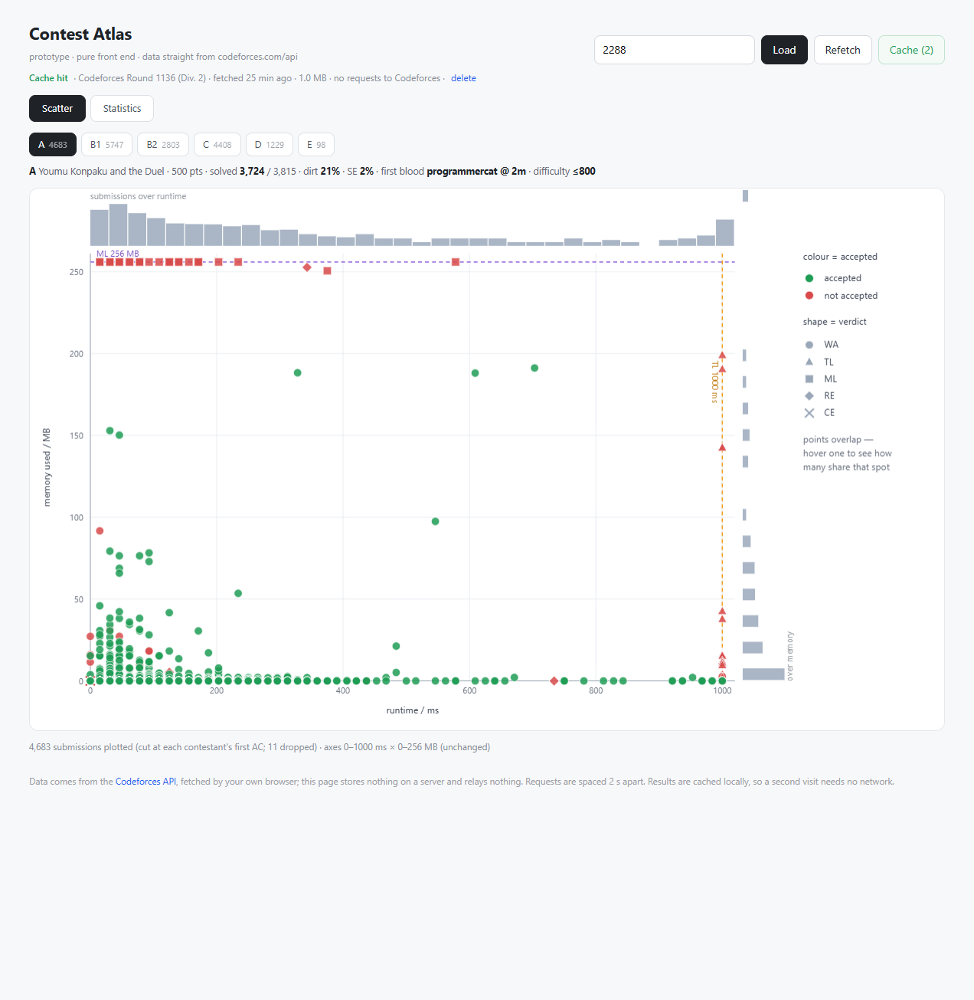
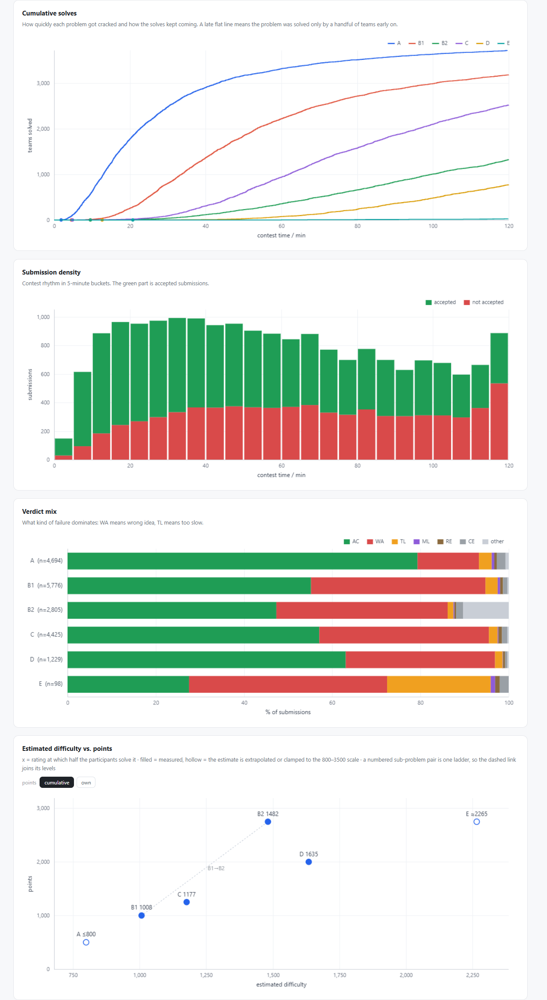

# Contest Atlas

[English](README.md) · **简体中文**

**从判题侧的视角看一场 Codeforces 比赛——全部在你的浏览器里完成，直连官方 API，没有后端，没有构建步骤。**

Codeforces 把一场比赛呈现成一份排名。这个工具把同一场比赛呈现成**分布**：每一条提交落在（运行时间，内存）平面上，
每道题的过题曲线、verdict 构成、首杀时间，以及一个难度估计——任意 contest id 都能看，从远古场次到刚结束一小时的那场。

所有计算都发生在访问者的机器上：没有服务器、没有代理、不要账号、不做统计。页面直接请求 `codeforces.com/api`，
结果存进 IndexedDB，所以第二次打开**完全不联网**。

在线：<https://lnight121.github.io/codeforces-contest-atlas/>



## 怎么用

直接用浏览器打开 `index.html` 就能跑（`file://` 可以，API 允许跨域）。或者起个静态服务：

```bash
python -m http.server 8000     # 然后打开 http://localhost:8000/#2289
```

输入 contest id，或者用 hash 深链：`#2289`。换题是点标签；`Statistics` 切到八张汇总图。

## 能看到什么

**散点（Scatter）**——和参考的 matplotlib 管线同一套画法：每条提交一个点，半径 5.2，绿色 = 通过、红色 = 未通过，
形状 = verdict（WA / TL / ML / RE / CE）。每位选手的提交**截到首次 AC 为止**，所以这张图回答的是"这些人为了做出来付出了什么"。
上下/左右两侧是边际直方图，TL/ML 两条墙画在真实位置上，鼠标悬停会告诉你**有多少条提交压在同一个点上**——
Codeforces 的运行时间量化到 1 ms、内存量化到 100 KB，所以重合是常态，不是噪声。

**统计（Statistics）**——参考管线里的八张图，全部在浏览器里现算：

| 图 | 说明 |
|---|---|
| Cumulative solves | 每题的累计过题曲线，圆点 = 首次通过 |
| Cumulative unsolves | 同一场比赛，换成看失败提交的累积 |
| Submission density | 每 5 分钟一桶的提交密度，通过数堆在上面 |
| First blood | 每题首次被做出来的时间，附 handle |
| Solves vs. attempts | 难度平面：过题人数 × 平均提交次数 |
| Submissions needed | 过题队伍各自用了几次提交 |
| Verdict mix | AC / WA / TL / ML / RE / CE / other 的 100% 堆叠 |
| Difficulty vs. points | 估计难度 vs 出题人给的分值；子题（A1、A2…）是一架阶梯——虚线把各级连起来，开关可切「累计分 / 本题自己的分」 |



## 数据从哪来

| 接口 | 为什么用它 |
|---|---|
| `contest.standings?contestId=` | 官方榜单——赛后从榜单里被移除的选手在这里天然被排除，不需要额外逻辑 |
| `contest.status?contestId=&from=&count=` | 这场比赛本身的提交 |
| `contest.ratingChanges?contestId=` | **一次请求**拿到全场的 `oldRating`，难度估计要用的赛前分 |

`contest.status` 是按新到旧返回的，赛后列表头部会堆上大量练习/虚拟参赛的提交，体量能到比赛本身的几十倍。
一页页翻太浪费，所以客户端改成"找边界"：在 10k、20k、40k… 处各探一行，直到落进比赛区间；再二分到 10k 以内；
最后**一次**批量请求把从那一点到末尾的全部取回。也就是几个一行的探测 + 一个大请求，最多多下不超过一档的练习数据。
如果尾部真的超过了单次请求上限，页面会明说，而不是假装数据是完整的。

有两样东西 API 不提供，只能推导：

- **时间/内存限制。** 没有任何方法返回它，所以从 verdict 反推：所有 `TIME_LIMIT_EXCEEDED` 里最大的运行时间、
  所有 `MEMORY_LIMIT_EXCEEDED` 里最大的内存。如果没有人撞墙，坐标上限就取观测最大值的圆整值，轴上会标 `(inferred)`。
- **难度。** 移植的参考估计器：分箱 50% 交叉点，加上一个 `P(求解 | rating)` 的 logistic 模型——斜率在"交叉点可识别"的
  题上合并估计。饱和的题用外推值，按 800–3500 夹取，两端写成 `≈1934`、`≤800`、`≥3500`。

## 实测成本（contest 2288）

| | |
|---|---|
| 首次访问 | 几次探测 + 1 个批量请求 · 21.9 MB · 约 14 s（2 s 的间隔是 API 规定的，不是我们加的） |
| 二次访问 | 0 请求 · 0 字节 · 秒开（IndexedDB 恢复） |
| 缓存体积 | 3,933 队 / 约 1.9 万条提交 → 1.03 MB（字符串抽成字典） |

缓存里只存原始行、官方名单和对应的赛前分；**所有派生数字**（难度、dirt、SE、直方图）都在载入时重算。
这样改了估计器不会被旧缓存挡住。缓存条目带版本号：别的构建写进去的条目会被忽略，而不是悄悄渲染出来。

顶部 `Cache` 按钮打开本地缓存面板：每场比赛的队数、占用、时间，以及 `open` / `delete`；还会显示浏览器自己报的
存储用量。淘汰策略是最多保留 20 场或 64 MB，按最近最少使用先丢，所以这个列表不会把 origin 的配额吃光。

## 有意的取舍

- **坐标轴绝不缩放。** 固定 `0 … TL×1.02` 和 `0 … ML×1.02`，和参考图一致。按数据自适应会让"墙"落在没有意义的位置，
  也会让两道题之间无法比较。
- **不对点云做平滑或填充。** 重合本身是信息，鼠标悬停会把它量化出来。
- **编号子题按「阶梯」读，不按「包含」读。** A1 和 A2 分开计分，所以能做出 A2 的人先交 A1 更划算——榜单付的是前缀和，图默认就画这个。`A2` 的题面到底包不包含 `A1`，只有出题人知道：提交数据分辨不出来，因为计分规则本来就把几乎所有 A2 的解题者推着先做 A1。所以图上只声明口径：虚线连接各级，开关提供边际读法。
- **没有 cookie、没有 analytics、不用 localStorage。** 结果只进 IndexedDB，一场一条，缓存面板可以逐条或一次性删掉。

## 已知局限

- 一次只加载一场比赛。Div.1 / Div.2 分成两个 contest 的场次需要加载两次（参考站点是并排展示的）。
- logistic 的合并斜率是个常数（`POOLED_SLOPE = 143.9`，在最近五场的语料上标定），不是每次访问都重算——
  单场比赛可识别的题太少，重算出来的斜率不稳。
- `exact` 的难度值会有几个 rating 点的抖动（实测最坏 **4 点**，出现在 2400 附近）：参考实现用的是不稳定排序，
  分箱边界正好切在同一分数的人群里时，答案是**真的有歧义**。外推和夹取出来的值是解析式的，能完全复现。
- 还没出 `ratingChanges` 的场次会退回分批 `user.info`，用的是**当前** rating，精度取决于那个。
- 比赛本身的提交被当成 `contest.status` 尾部一整块连续区间。目前为止见过的场次都成立，但如果哪场比赛把练习数据
  混进了列表中间，就得退回逐页扫描的老办法。
- 大场次对计算毫无压力，但首次抓取会被 2 s 的节奏拖住。

## 数据、条款与许可

**代码**使用 MIT 许可（见 `LICENSE`）。

**数据不属于这个仓库，也没有被再分发**：每个访问者的浏览器自己去 Codeforces 取，服务端不存任何东西，
请求间隔按 API 要求保持 2 s。没有广告、不卖任何东西——参考
[Codeforces Terms and Conditions](https://codeforces.com/terms)。本项目与 Codeforces 无隶属关系，是非官方工具。
handle 和 verdict 只以 API 公开的形态出现。

## 文件

```
index.html   页面结构与两个视图
app.js       API 客户端、数据整形、难度估计、canvas 渲染、IndexedDB 缓存
app.css      样式
docs/        README 用的截图
```

没有依赖、没有打包器、没有构建步骤。`app.js` 是普通 classic script，所以直接从磁盘打开也能跑。

## 致谢

散点和八张统计图都移植自一份本地的 Python / pandas / matplotlib 管线（`plot_problem.py`、`charts.py`、
`difficulty.py`），两套实现应当给出同样的数字。比赛数据来自
[Codeforces API](https://codeforces.com/apiHelp)。
